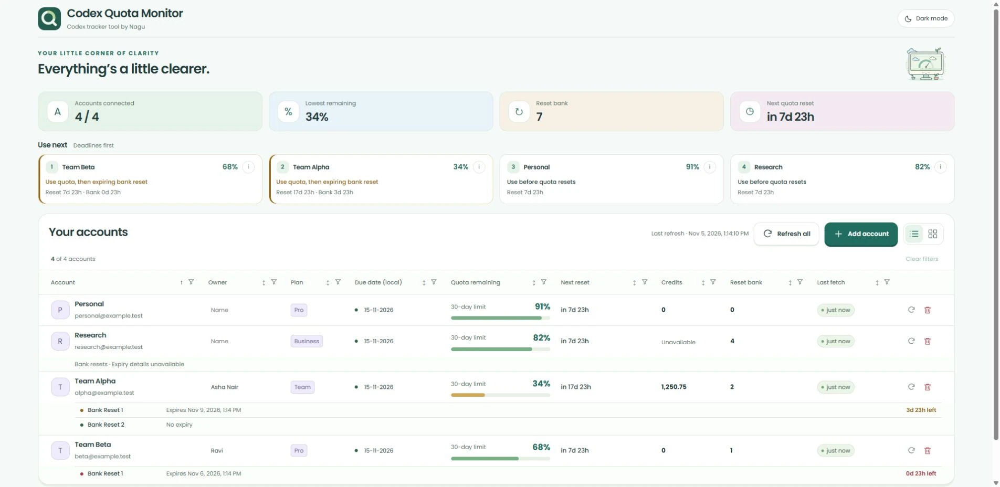

# Codex Quota Monitor

A calm desktop dashboard for your Codex accounts, by [Nagu](https://nagu.co/).

**Windows 1.5.0** is the current direct-download release. Get the [EXE or ZIP](https://codex-tracker.nagu.co/#downloads) from the product website or [GitHub Releases](https://github.com/nagu-code/codex-quota-monitor/releases/tag/v1.5.0).

## What is included

- Compact light and dark themes, Poppins typography and a new product mark.
- Multiple authorized accounts, remaining quota, reset times, credits and individual bank-reset expiries.
- Four suggested next accounts with an explanation, including bank resets nearing expiry.
- Editable owner and due date, colored urgency dots, sorting and column filters.
- Refresh on launch, a Refresh all button, and an hourly refresh measured from the last refresh.
- A read-only LAN mirror with the same readings and suggestions; teammates can request Refresh all. No second Codex login is needed.
- No historical charts, desktop analytics, advertising or telemetry.

## Requirements and installation

Windows x64, Internet access and a browser for the official Codex sign-in. Windows 11 is the platform exercised for this release; Windows 10 compatibility is configured but native acceptance was not repeated. No Node.js or source checkout is needed. macOS/Linux native validation is pending; no installers for those platforms are published in this release. Microsoft Store enrollment and certification are also pending.

Two distributions contain the same application resources:

1. **Unsigned EXE:** the simplest download. Windows can display Unknown publisher or SmartScreen warnings.
2. **Locally self-signed ZIP:** includes the signed installer, public certificate, current-user trust/removal scripts and verification files. A self-signed certificate is not a publicly trusted CA signature. Installing it extends trust beyond this application, and uninstalling the app does not remove that trust.

Follow [INSTALLATION.txt](INSTALLATION.txt), including the complete hash and signature checks. Independent verification values are published on [Nagu's verification page](https://nagu.co/codex-quota-monitor-trust.html). Do not bypass your organization's security policy.

## Local data and LAN sharing

The app stores account metadata and saved credentials on the collector computer. On Windows, saved credentials use DPAPI for the current Windows user. Authentication and quota requests contact OpenAI. The bundled Codex helper may temporarily require an authentication file; see the full [product privacy notice](PRIVACY.md).

LAN sharing starts with the app. Anyone who can reach its HTTP IP address and port can see account names, email addresses, owners, due dates and quota readings, and request a refresh. There is no password or transport encryption on this local view. Credentials and account-management controls are not shared. Use only on a trusted network and do not expose the port to the Internet.

Removing an account moves its data to the app's Trash. Uninstalling preserves the application-data directory. See [PRIVACY.md](PRIVACY.md) for deletion and retention details; do not send credentials or account-data folders in support reports.

## Release verification

The release was built from the exact annotated source revision recorded in [the artifact manifest](docs/releases/v1.5.0.json). [Verification results and remaining platform limitations](docs/releases/v1.5.0-verification.json) are published alongside it. This direct release does not claim historical Phase 8/9 certification or Microsoft Store certification. Old release candidates remain identifiable as prereleases.

This public repository contains distribution documentation and verification tooling. The proprietary application source is maintained privately. The application is freeware, not open source; the complete [license](LICENSE.txt) controls use and redistribution. See [third-party notices](THIRD-PARTY-NOTICES.md).

## Help and publisher

[Product website](https://codex-tracker.nagu.co/) · [Nagu](https://nagu.co/) · [Support](SUPPORT.md) · [Security](SECURITY.md)

General help: hello@nagu.co. Privacy, security and legal contact: kj@nagu.co.

Published by Nagu Corporate Private Limited. Independent of OpenAI; OpenAI, ChatGPT and Codex are trademarks of their respective owners. See [TRADEMARKS.md](TRADEMARKS.md).
